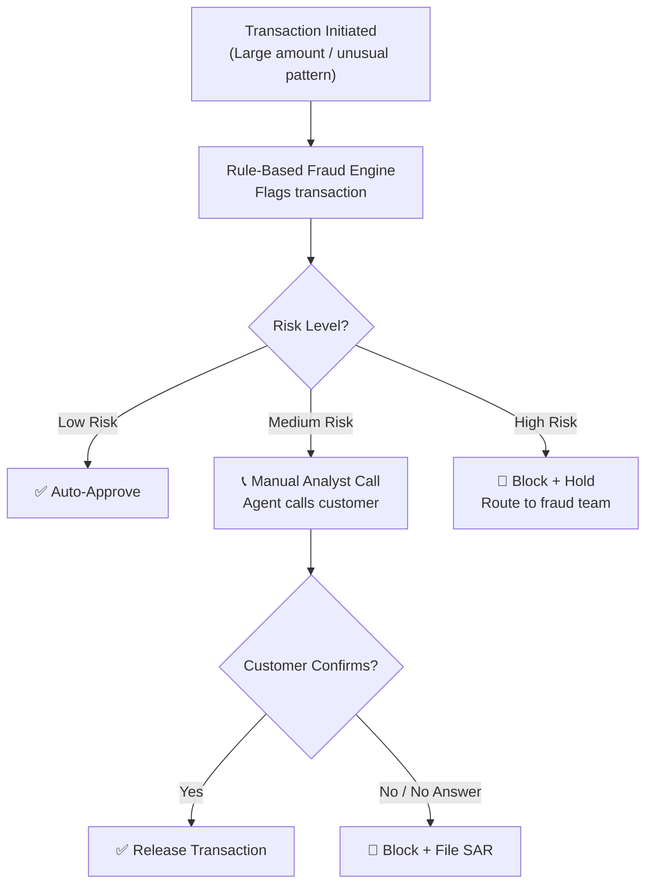
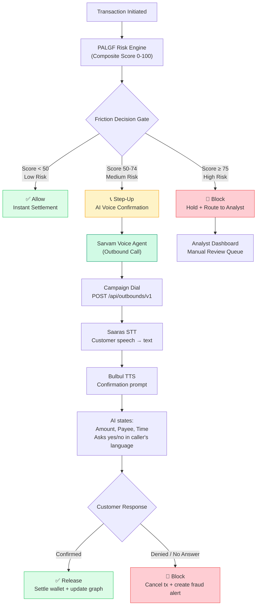

# AI Voice Confirmation System — Sarvam TTS/STT Integration into NextGenAML

Automate the bank's transaction verification call flow using Sarvam AI's Voice Agent platform. When the PALGF risk engine (your existing composite scoring system) flags a transaction as medium-to-high risk, an AI voice agent places an outbound call to the customer to confirm, deny, or escalate — replacing manual analyst phone calls.

---

## User Review Required

> [!IMPORTANT]
> **Sarvam API Credentials Required**: You need a Sarvam AI account with:
> - A **Model API key** (from `dashboard.sarvam.ai`) for TTS/STT
> - A **Voice Agent Workspace API key** (from `apps.sarvam.ai`) for outbound calling
> - An `org_id`, `workspace_id`, `app_id`, and `connection_id` from the Sarvam Voice Agent dashboard
> - A configured telephony connection (Exotel, Twilio, or Sarvam-managed number)
>
> **Do you already have these credentials, or should we implement a demo/mock mode first?**

> [!WARNING]
> **Current Gap — No Pre-Settlement Gate**: Your existing `SimulatorService.process_transaction()` settles transactions (wallet debit/credit) **immediately** and raises alerts post-facto. This plan moves risk evaluation **before** settlement so high-risk transactions can be held pending voice confirmation.

## Open Questions

1. **Risk Threshold for Voice Calls**: The flow diagram shows Low / Medium / High risk. Your current thresholds are:
   - LOW: `< 25` → Allow
   - MEDIUM: `25–49` → Under Review
   - HIGH: `50–74` → Flagged
   - CRITICAL: `≥ 75` → Critical

   **Which threshold should trigger an outbound voice call?** Options:
   - `≥ 50` (HIGH + CRITICAL) → Step-Up voice confirmation
   - `≥ 75` (CRITICAL only) → Voice confirmation, everything else auto-decided
   - `≥ 25` (MEDIUM and above) → Most aggressive

2. **Amount-Based Trigger**: Should large transactions (e.g., > ₹5,00,000) always trigger a voice call regardless of risk score?

3. **Call Timeout Policy**: If the customer doesn't answer or doesn't respond within X seconds, should the transaction be auto-blocked or held for manual analyst review?

4. **Language Preference**: Sarvam supports 11+ Indian languages. Should the voice agent speak in Hindi, English, or should it detect/follow the customer's registered language preference?

5. **Demo vs Production Mode**: For the hackathon demo, should we implement:
   - **Full Sarvam integration** (requires live API keys + telephony setup)
   - **Mock/simulation mode** (simulates the call flow in the frontend UPI phone with browser TTS/STT)
   - **Both** (mock mode by default, real Sarvam calls when API keys are configured)

---

## Current Methodology — How Banks Do It Today



**Problems with current manual approach:**
- **Slow**: Human agents take 5–15 minutes per call, creating settlement delays
- **Expensive**: Dedicated call center staff for verification
- **Limited hours**: Staff unavailable 24/7
- **Language barriers**: Agents may not speak the customer's preferred language
- **No scalability**: Can't handle spikes in flagged transactions

---

## Proposed Architecture — AI Voice Confirmation with Sarvam



---

## Proposed Changes

### Component 1: Backend — Voice Auth Service (New)

This is the core new module that integrates with Sarvam's outbound calling API.

---

#### [NEW] [`voice_auth_service.py`](file:///d:/Downloads/NENE/NextGenAML-NIT/api/voice_auth_service.py)

The central orchestrator for voice-based transaction confirmation.

**Key responsibilities:**
- Manage pending voice confirmation transactions (in-memory store with TTL)
- Trigger outbound Sarvam calls with transaction context
- Process webhook callbacks from Sarvam with call results
- Execute deferred settlement (wallet debit/credit) on confirmation
- Auto-block on denial/timeout

```python
class VoiceAuthService:
    """Manages voice-based transaction confirmation via Sarvam AI."""
    
    def __init__(self, config, simulator_service):
        self.pending_confirmations: dict[str, PendingConfirmation] = {}
        self.sarvam_client = SarvamVoiceClient(config)
        self.simulator = simulator_service
        self.call_timeout_seconds = 120  # 2 min timeout
    
    async def hold_transaction(self, tx: dict, tx_risk: dict) -> str:
        """Hold a transaction and initiate voice verification."""
        # Store tx in pending state (don't settle wallet)
        # Trigger Sarvam outbound call
        # Return confirmation_id
    
    async def trigger_sarvam_call(self, confirmation_id: str, tx: dict, account: dict):
        """POST to Sarvam outbound API with transaction details."""
        # Uses initial_agent_variables to pass:
        #   customer_name, amount, payee_name, transaction_time, tx_id
    
    async def process_webhook(self, payload: dict) -> dict:
        """Handle Sarvam webhook callback after call completes."""
        # Extract call_disposition from output_agent_variables
        # If confirmed → settle wallet, update graph, broadcast SUCCESS
        # If denied/timeout → cancel tx, create fraud alert, broadcast BLOCKED
    
    async def check_timeouts(self):
        """Background task to auto-block expired pending confirmations."""
```

**Data model for pending confirmations:**
```python
@dataclass
class PendingConfirmation:
    confirmation_id: str
    transaction: dict
    tx_risk: dict
    status: str  # "calling", "in_progress", "confirmed", "denied", "timeout", "no_answer"
    created_at: datetime
    sarvam_interaction_id: Optional[str]
    call_transcript: Optional[list]
    call_duration: Optional[float]
```

---

#### [NEW] [`sarvam_client.py`](file:///d:/Downloads/NENE/NextGenAML-NIT/api/sarvam_client.py)

Low-level HTTP client wrapping Sarvam's APIs.

```python
class SarvamVoiceClient:
    """HTTP client for Sarvam AI Voice Agent + Model APIs."""
    
    BASE_URL = "https://apps.sarvam.ai/api/outbounds/v1"
    TTS_URL = "https://api.sarvam.ai/text-to-speech"
    STT_URL = "https://api.sarvam.ai/speech-to-text"
    
    def __init__(self, config):
        self.api_key = config.SARVAM_VOICE_AGENT_KEY
        self.model_api_key = config.SARVAM_MODEL_API_KEY
        self.org_id = config.SARVAM_ORG_ID
        self.workspace_id = config.SARVAM_WORKSPACE_ID
        self.app_id = config.SARVAM_APP_ID
        self.connection_id = config.SARVAM_CONNECTION_ID
        self.agent_phone = config.SARVAM_AGENT_PHONE
        self.webhook_url = config.SARVAM_WEBHOOK_URL
    
    async def initiate_outbound_call(self, phone: str, variables: dict) -> dict:
        """Trigger instant outbound call via Sarvam Voice Agent."""
    
    async def text_to_speech(self, text: str, language: str = "hi-IN") -> bytes:
        """Convert text to speech audio using Bulbul v3 (for demo/preview)."""
    
    async def speech_to_text(self, audio_bytes: bytes, language: str = "unknown") -> str:
        """Transcribe audio using Saaras v3 (for demo/preview)."""
```

---

#### [NEW] [`voice_auth_router.py`](file:///d:/Downloads/NENE/NextGenAML-NIT/api/routers/voice_auth.py)

New FastAPI router exposing voice confirmation endpoints.

| Endpoint | Method | Purpose |
|---|---|---|
| `/voice/pending` | `GET` | List all transactions pending voice confirmation |
| `/voice/pending/{confirmation_id}` | `GET` | Get status of a specific pending confirmation |
| `/voice/call/initiate/{confirmation_id}` | `POST` | Manually re-trigger a voice call |
| `/voice/webhook/sarvam` | `POST` | Sarvam webhook callback (call result) |
| `/voice/confirm/{confirmation_id}` | `POST` | Manual analyst confirm/deny (override) |
| `/voice/settings` | `GET/PUT` | Get/update voice auth thresholds and config |
| `/voice/stats` | `GET` | Voice auth statistics (calls made, confirmed, denied, timeout) |
| `/voice/tts/preview` | `POST` | Preview TTS audio for a transaction (demo) |

---

### Component 2: Backend — Transaction Pipeline Modification

---

#### [MODIFY] [`service.py`](file:///d:/Downloads/NENE/NextGenAML-NIT/simulator/service.py)

**Critical change**: Move risk evaluation **before** wallet settlement.

```diff
 # Current flow (simplified):
-wallet.debit(sender, amount)
-wallet.credit(receiver, amount)
-tx_risk = _evaluate_transaction_risk(tx)
-if tx_risk["score"] >= 50:
-    alert_registry.create(...)

 # New flow:
+tx_risk = _evaluate_transaction_risk(tx)
+
+if tx_risk["score"] >= 75:  # HIGH RISK → Block immediately
+    tx["status"] = "blocked"
+    tx["block_reason"] = "High risk - auto blocked"
+    alert_registry.create(...)
+    # Do NOT settle wallet
+
+elif tx_risk["score"] >= 50:  # MEDIUM RISK → Step-up voice confirmation
+    tx["status"] = "pending_voice_confirmation"
+    confirmation = await voice_auth_service.hold_transaction(tx, tx_risk)
+    # Do NOT settle wallet yet — deferred until voice confirmation
+    # Broadcast VOICE_CONFIRMATION_REQUIRED over WebSocket
+
+else:  # LOW RISK → Allow
+    wallet.debit(sender, amount)
+    wallet.credit(receiver, amount)
+    tx["status"] = "success"
```

---

#### [MODIFY] [`config.py`](file:///d:/Downloads/NENE/NextGenAML-NIT/api/config.py)

Add Sarvam AI configuration variables.

```python
# --- Sarvam AI Voice Authentication ---
SARVAM_VOICE_AGENT_KEY = os.getenv("SARVAM_VOICE_AGENT_KEY", "")
SARVAM_MODEL_API_KEY = os.getenv("SARVAM_MODEL_API_KEY", "")
SARVAM_ORG_ID = os.getenv("SARVAM_ORG_ID", "")
SARVAM_WORKSPACE_ID = os.getenv("SARVAM_WORKSPACE_ID", "")
SARVAM_APP_ID = os.getenv("SARVAM_APP_ID", "")
SARVAM_CONNECTION_ID = os.getenv("SARVAM_CONNECTION_ID", "")
SARVAM_AGENT_PHONE = os.getenv("SARVAM_AGENT_PHONE", "")
SARVAM_WEBHOOK_URL = os.getenv("SARVAM_WEBHOOK_URL", "http://localhost:8089/voice/webhook/sarvam")
VOICE_AUTH_ENABLED = os.getenv("VOICE_AUTH_ENABLED", "true").lower() == "true"
VOICE_AUTH_THRESHOLD = int(os.getenv("VOICE_AUTH_THRESHOLD", "50"))
VOICE_AUTH_BLOCK_THRESHOLD = int(os.getenv("VOICE_AUTH_BLOCK_THRESHOLD", "75"))
VOICE_AUTH_TIMEOUT_SECONDS = int(os.getenv("VOICE_AUTH_TIMEOUT_SECONDS", "120"))
VOICE_AUTH_LANGUAGE = os.getenv("VOICE_AUTH_LANGUAGE", "hi-IN")
VOICE_AUTH_MOCK_MODE = os.getenv("VOICE_AUTH_MOCK_MODE", "true").lower() == "true"
```

---

#### [MODIFY] [`.env.example`](file:///d:/Downloads/NENE/NextGenAML-NIT/.env.example)

Document all new environment variables.

---

#### [MODIFY] [`main.py`](file:///d:/Downloads/NENE/NextGenAML-NIT/api/main.py)

Mount the new `/voice` router and initialize `VoiceAuthService`.

---

#### [MODIFY] [`requirements.txt`](file:///d:/Downloads/NENE/NextGenAML-NIT/requirements.txt)

Add `sarvamai` SDK dependency.

```diff
+sarvamai>=0.4.0
```

---

### Component 3: Frontend — Voice Confirmation UI

---

#### [NEW] [`VoiceConfirmation.tsx`](file:///d:/Downloads/NENE/NextGenAML-NIT/nextgen-frontend/src/components/simulator/VoiceConfirmation.tsx)

A modal/overlay component shown inside the UPI Phone mockup when a transaction enters `pending_voice_confirmation` status.

**UI Elements:**
- 📞 Animated incoming call screen with bank logo + "Verification Call"
- Pulsing phone ring animation
- Transaction details: amount, payee, time
- Voice waveform visualization (using Web Audio API)
- "Accept Call" / "Decline Call" buttons
- After accepting: plays TTS audio of the verification prompt
- "Confirm Transaction" / "Report Fraud" action buttons
- Real-time status badge: Calling → Connected → Awaiting Response → Confirmed/Denied

---

#### [NEW] [`VoiceAuthDashboard.tsx`](file:///d:/Downloads/NENE/NextGenAML-NIT/nextgen-frontend/src/components/VoiceAuthDashboard.tsx)

A new section on the alerts page or a dedicated page showing:
- List of pending voice confirmations with countdown timers
- Call history with transcripts and outcomes
- Stats: total calls, confirmation rate, avg response time
- Manual override buttons for analysts

---

#### [MODIFY] [`UpiPhone.tsx`](file:///d:/Downloads/NENE/NextGenAML-NIT/nextgen-frontend/src/components/simulator/UpiPhone.tsx)

When payment response indicates `pending_voice_confirmation`:
- Transition from "Payment Processing" to "Incoming Verification Call" screen
- Render the `VoiceConfirmation` component inside the phone frame

---

#### [MODIFY] [`useLiveTransactions.ts`](file:///d:/Downloads/NENE/NextGenAML-NIT/nextgen-frontend/src/lib/useLiveTransactions.ts)

Handle new WebSocket event types:
- `VOICE_CONFIRMATION_REQUIRED` — trigger call UI
- `VOICE_CONFIRMATION_RESULT` — update transaction status

---

#### [MODIFY] [`api.ts`](file:///d:/Downloads/NENE/NextGenAML-NIT/nextgen-frontend/src/lib/api.ts)

Add API client functions for voice auth endpoints:
```typescript
getVoicePendingConfirmations()
getVoiceConfirmationStatus(confirmationId: string)
confirmVoiceAuth(confirmationId: string, confirmed: boolean)
getVoiceStats()
previewTTS(text: string, language: string)
```

---

### Component 4: Mock Mode (Demo/Hackathon)

For the hackathon demo without live Sarvam API keys, implement a mock mode:

#### [NEW] [`mock_voice_service.py`](file:///d:/Downloads/NENE/NextGenAML-NIT/api/mock_voice_service.py)

- Simulates the Sarvam call flow with configurable delays
- Generates mock transcripts
- Auto-responds after a configurable delay (simulating customer picking up)
- Frontend plays browser-native TTS (`window.speechSynthesis`) as fallback
- Random outcome distribution: 70% confirm, 20% deny, 10% no answer

---

## File Summary

| Action | File | Purpose |
|---|---|---|
| **NEW** | `api/voice_auth_service.py` | Core voice confirmation orchestrator |
| **NEW** | `api/sarvam_client.py` | Sarvam API HTTP client |
| **NEW** | `api/routers/voice_auth.py` | FastAPI router for voice endpoints |
| **NEW** | `api/mock_voice_service.py` | Mock mode for demo without API keys |
| **NEW** | `nextgen-frontend/src/components/simulator/VoiceConfirmation.tsx` | Incoming call UI in UPI phone |
| **NEW** | `nextgen-frontend/src/components/VoiceAuthDashboard.tsx` | Analyst dashboard for voice auth |
| MODIFY | `simulator/service.py` | Move risk eval before settlement |
| MODIFY | `api/config.py` | Add Sarvam config variables |
| MODIFY | `api/main.py` | Mount voice router + init service |
| MODIFY | `.env.example` | Document new env vars |
| MODIFY | `requirements.txt` | Add `sarvamai` dependency |
| MODIFY | `nextgen-frontend/src/components/simulator/UpiPhone.tsx` | Integrate voice call UI |
| MODIFY | `nextgen-frontend/src/lib/useLiveTransactions.ts` | Handle new WS events |
| MODIFY | `nextgen-frontend/src/lib/api.ts` | Add voice API client functions |

---

## Verification Plan

### Automated Tests
```bash
# Run existing tests to ensure no regression
cd d:\Downloads\NENE\NextGenAML-NIT
python -m pytest tests/ -v

# Test voice auth endpoints
python -m pytest tests/test_voice_auth.py -v
```

### Manual Verification
1. **Mock Mode Flow**:
   - Start backend with `VOICE_AUTH_MOCK_MODE=true`
   - Execute a high-value transaction via the UPI simulator
   - Verify the transaction enters `pending_voice_confirmation` status
   - Verify the phone UI shows incoming call animation
   - Confirm/deny and verify wallet settlement behavior

2. **Live Sarvam Mode** (if API keys available):
   - Configure all `SARVAM_*` environment variables
   - Set `VOICE_AUTH_MOCK_MODE=false`
   - Execute a flagged transaction
   - Verify an actual outbound call is placed
   - Verify webhook callback processes correctly

3. **Threshold Tuning**:
   - Test with different `VOICE_AUTH_THRESHOLD` values
   - Verify low-risk transactions bypass voice auth
   - Verify high-risk transactions are auto-blocked
